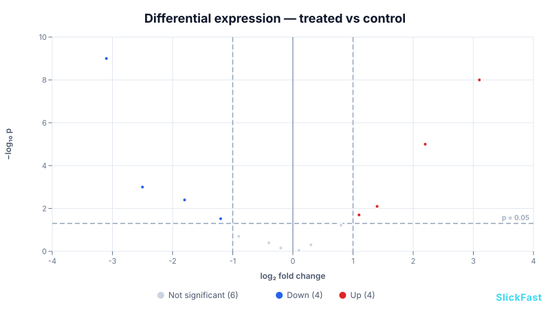

# sci-core — scientific charts for SlickFast

Eight chart types for lab and research data, drawn by the same deterministic engine as the
rest of SlickFast: a JSON spec in, an SVG out, the same bytes every time. No browser, no
plotting library.



## The eight types

| Type | What it draws |
|---|---|
| `scatter` | Points, with optional error bars, fitted curve and log axes (`semilog-x`, `semilog-y`, `loglog`) |
| `errorbar` | Mean ± error per group or per x value |
| `lineplot` | Lines over linear or log axes (growth curves, dose response) |
| `barplot` | Bars with error bars, linear or log value axis |
| `survival` | Kaplan–Meier survival curves with censor marks |
| `blandaltman` | Bland–Altman agreement plot: mean difference and limits of agreement |
| `qq` | Normal Q–Q plot with reference line |
| `volcano` | Fold change vs significance, points coloured up / down / not significant |

Colours come from SlickFast's palette library (same palette names as the 47 core types).

## Use it

**From an AI agent** — the SlickFast MCP server includes all eight types:

```bash
npx -y @slickfast/mcp
```

Ask for a volcano plot, a survival curve, a Q–Q plot, and so on.

**From JavaScript** — clone this repo, then:

```js
import { renderSciSpec } from './packages/sci-core/sci-core.mjs';

const svg = renderSciSpec({
  type: 'volcano',
  title: 'Differential expression — treated vs control',
  fc: [-3.1, -2.5, -1.8, -1.2, -0.9, -0.4, 0.1, 1.1, 1.4, 2.2, 3.1],
  p:  [1e-9, 0.001, 0.004, 0.03, 0.2, 0.4, 0.9, 0.02, 0.008, 1e-5, 1e-8],
});
```

`renderSciSpec(spec)` is a pure function: spec in, SVG string out. It reads no files, no
network, no clock.

The example above lives in [`examples/`](examples/). Render every spec there with:

```bash
node packages/sci-core/examples/render.mjs
```

## Checks

```bash
node packages/sci-core/golden/generate.mjs --check   # 27 reference SVGs, byte for byte
node packages/sci-core/verify-stats.mjs              # statistics checked against known values
```

## Files

| File | Role |
|---|---|
| `sci-core.mjs` | The eight renderers and `renderSciSpec` |
| `fit-stats.mjs` | Curve fitting and statistics helpers |
| `log-scale.mjs` | Log axes, ticks and labels |
| `shell.mjs` | Shared SVG chrome, matched to render-core |
| `golden/` | Regression net: fixed specs and their exact SVG output |
| `examples/` | Example specs and their rendered SVGs |

License: same as this repository (AGPL-3.0, with a commercial license available — see the root README).
